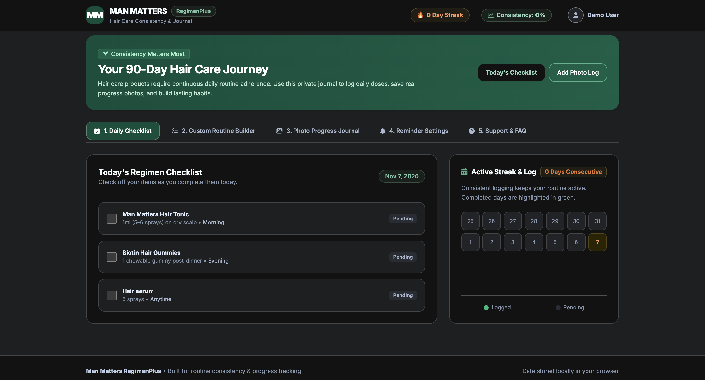
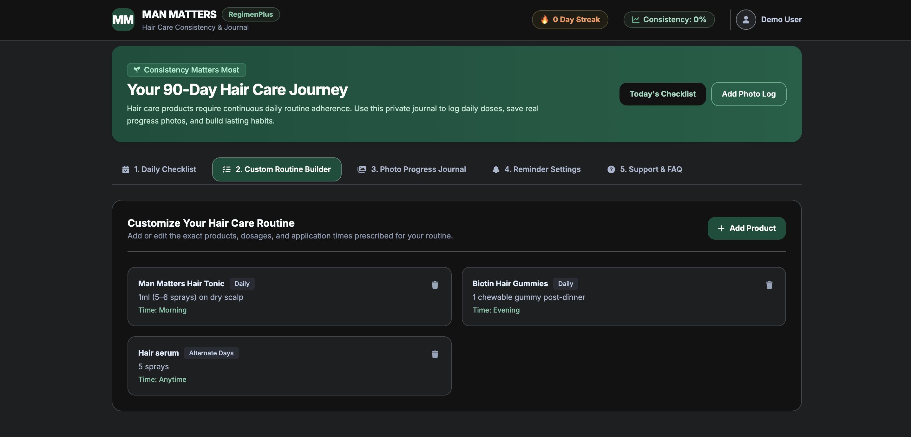
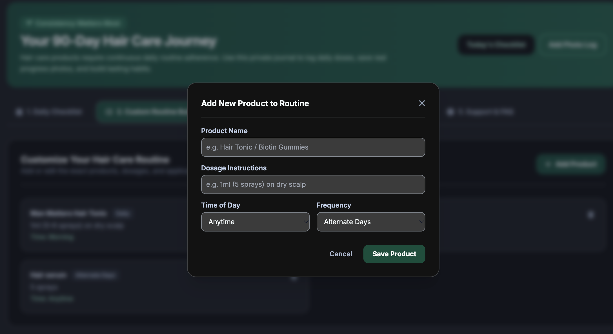
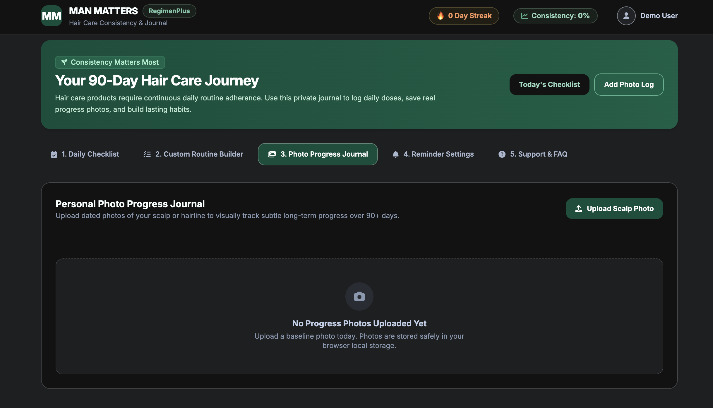
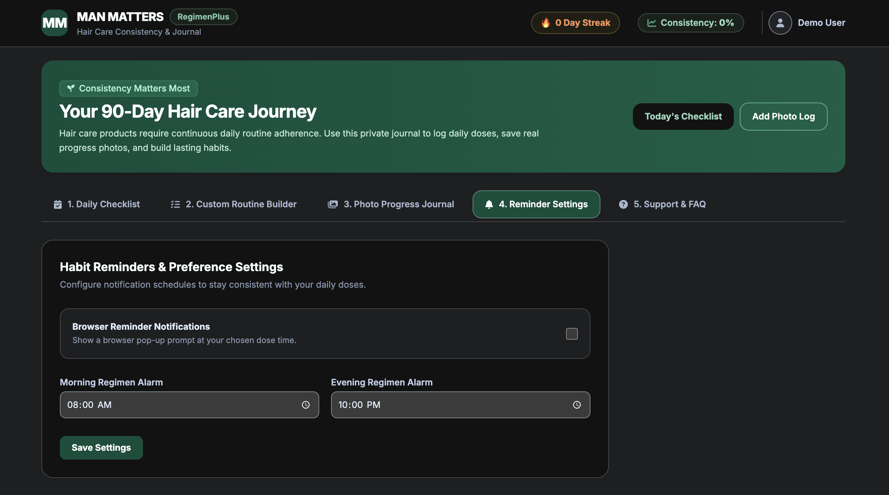
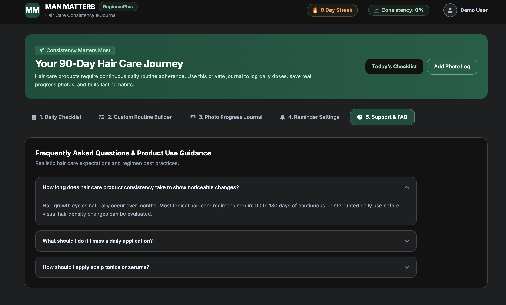

# Mosaic-Wellness-project

**Man Matters RegimenPlus – Haircare Routine & Progress Companion**

RegimenPlus is a consumer-facing web application designed to help Man Matters customers stay consistent with their haircare routines and track their progress over time.

The application includes a customisable product routine builder, daily usage tracking, consistency monitoring, a personal photo progress journal, and reminder preferences.

The idea is to make it easier for customers to maintain their routines and track gradual changes instead of relying entirely on memory. The application was developed using AI-assisted coding.

---

## 📸 Application Screenshots & Features

### 1. Daily Checklist & Streak Tracker
View today's regimen checklist, check off completed applications, and track active usage streaks along with monthly calendar logging.

### 2. Custom Routine Builder
Manage your active haircare regimen by viewing prescribed products, dosages, and application frequencies.

### 3. Add Custom Product Modal
Easily add new products, specify dosages, choose preferred time of day (Morning/Evening/Anytime), and set routine frequency.

### 4. Personal Photo Progress Journal
Upload dated scalp photos to securely build a visual baseline and track micro-growth progress locally in your browser over 90+ days.

### 5. Habit Reminders & Preference Settings
Configure daily notification preferences and custom morning/evening alarm times to ensure consistent daily doses.

### 6. Frequently Asked Questions & Regimen Guidance
Access practical, realistic product use guidance, expectation management, and FAQ accordions.
